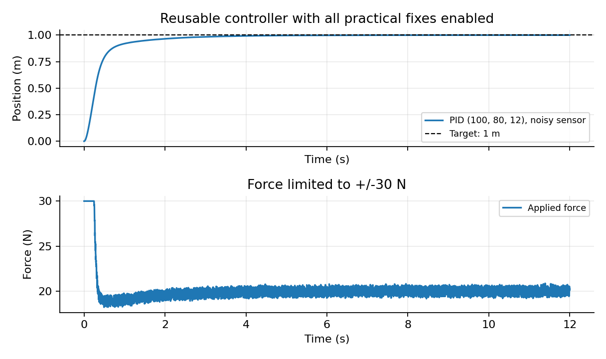

# PID control assignment

A short explanation of PID control, with Python simulations of a 1 kg mass connected to a spring and damper. The controller is written from scratch using NumPy and Matplotlib, without a control library.

## Submission files

- [Learning PID control (PDF, 13 pages)](output/pdf/pid_control.pdf)
- [Brief project summary](WRITEUP.md)
- [Controller code](pid.py)
- [Results and measurements](results/)

## Approach

I started with the force balance `x'' + 10x' + 20x = u`. I compared P, PI, PD and PID, then tested force saturation, sensor noise, derivative kick and slower controller updates. A second plant, `1/(s+1)^3`, is used for Ziegler-Nichols tuning.

I used the Runge-Kutta method of order four to simulate the plant. The controller holds the force constant between updates, and the plant takes steps of 0.002 s or less. That lets me test slow controller updates without also making the simulation less accurate. Noise is uniform within +/-1 mm, using seed 17.

The PDF includes one worked controller update and a small comparison of PID gains explaining the final choice. The gain comparison in `results/gain_trials.csv` uses the same conditions as the P, PI, PD and PID comparison. Both runs omit noise and the force limit.

## Setup

Use Python 3.11 or newer. The submission was checked with Python 3.14.3. Run these commands in the repository folder.

Windows PowerShell:

```powershell
python -m venv .venv
.\.venv\Scripts\python.exe -m pip install -r requirements.txt
.\.venv\Scripts\python.exe run.py --report
```

macOS or Linux:

```bash
python3 -m venv .venv
.venv/bin/python -m pip install -r requirements.txt
.venv/bin/python run.py --report
```

The final command recreates all 13 figures, the CSV and JSON measurements in `results/`, and `output/pdf/pid_control.pdf`. To generate only the plots and measurements, run `python run.py` with the environment's Python. No display, API key, downloaded dataset or external service is needed.

## Code layout

| File | Purpose |
| --- | --- |
| `pid.py` | PID state, output limits, conditional integration and filtered derivative |
| `simulation.py` | Both plant models, integration with constant force between updates and response measures |
| `run.py` | Experiments, plots and saved measurements |
| `report.py` | Builds the PDF from the experiment results |
| `tests/test_pid.py` | Checks equations, saturation, noise, kick, repeatability and convergence with smaller time steps |

To try different gains, change `GAINS` in `run.py`. `simulate` also accepts `mass`, `dt`, `noise`, `duration`, `seed` and a target function. Change `limits` and `tau` on the `PID` object to test a different actuator limit or derivative filter. The separate windup demonstration uses `(100, 200, 8)` to make the problem easy to see.

Example:

```python
from pid import PID
from simulation import simulate, metrics

controller = PID(100, 80, 12, limits=(-30, 30), tau=0.02)
result = simulate(controller, mass=1.0, dt=0.002, noise=0.001)
print(metrics(result))
```

`metrics` is for a step from rest to a constant target of 1. Rise time runs from the first crossing of 10% of the target to the first crossing of 90%. Overshoot is measured relative to the target. The response settles once it stays within 2% of the target for the rest of the run. `None` means the threshold was not reached in the simulated time. Final error is measured at the end of the run. For the second plant, the error is dimensionless rather than metres.

## Main result

The chosen gains are `Kp = 100`, `Ki = 80`, `Kd = 12`, with a 0.02 s derivative filter. With the +/-30 N limit and +/-1 mm measurement noise, the response has:

| Measure | Result |
| --- | --- |
| Rise time | 0.729 s |
| Overshoot | 0.011% |
| Settling time | 2.710 s |
| Error at 12 s | 0.0000068 m |



These values describe this simulated model. The unconstrained comparison has different numbers because its force is not limited. No hardware validation is included.

## Checks

```bash
python -m unittest discover -s tests -v
```

Use the virtual environment's Python as in the setup commands. The nine checks cover the calculated equilibrium with P alone, integral holding force, anti-windup and recovery, output bounds, derivative kick, filtering, repeatability, convergence as the update interval shrinks, and invalid time steps.

## References

- [University of Michigan: Introduction to PID Controller Design](https://ctms.engin.umich.edu/CTMS/index.php?example=Introduction&section=ControlPID)
- [University of Michigan: Ziegler-Nichols tuning table](https://eecs.umich.edu/courses/eng100/lec5/ZieglerNichols.html)
